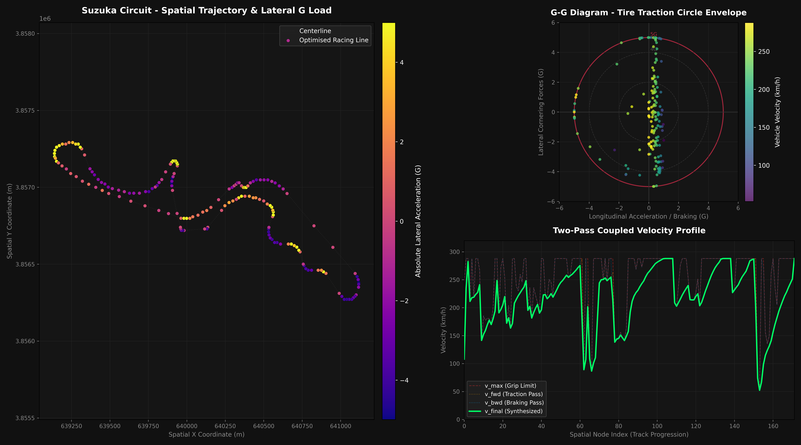

# 🏎️ F1 Laptime Simulator & Racing Line Optimiser

An advanced, high-performance **F1 Laptime Simulator and Trajectory Optimiser** built using **modern C++ (C++17)** for the core physics pipeline and **Python** for high-fidelity visualisation and telemetry processing. 

The engine simulates Formula 1 vehicle dynamics by coupling multi-sector longitudinal acceleration solvers with a reactive lateral grip constraint framework, optimising racing lines via highly robust numerical gradient descent.



---

## 🚀 Key Technical Features

- **High-Performance C++17 Core Engine:** Implements a decoupled structure (Headers/Sources) ensuring fast build cycles, explicit memory safety, and robust file I/O operations using `<filesystem>`.
- **Coupled Two-Pass Velocity Solver Architecture:** Features a robust forward-backward velocity pass that reconciles powertrain capabilities, mechanical traction circles, and speed-dependent aerodynamic drag to extract the absolute physics-limited performance envelope.
  - *Forward Pass:* Computes acceleration capabilities bounded by engine power and exit traction limits.
  - *Backward Pass:* Integrates deceleration vectors in reverse from the apex to accurately determine the exact theoretical **Braking Points**, eliminating legacy velocity spikes.
- **2nd-Order Central Difference Gradient Descent:** Shakes off centerline rigidity by computing highly accurate dual-sided numerical derivatives via a 2nd-order Central Difference Method. This guarantees balanced spatial gradient alignment across both left and right directional changes.

$$G_i = \frac{T_{\text{plus}}(s_i + h) - T_{\text{minus}}(s_i - h)}{2h}$$

- **Continuous Cyclical Laplacian Filtering:** Integrates a cyclical 3-point moving average filter utilizing Cyclic Wrap-Around Indexing. This actively suppresses numerical noise and guarantees complete C² geometric continuity across the start/finish straight.

$$\text{idx}_{\text{prev}} = (i - 1 + N) \pmod N$$

- **Energy-Based G-Force Modeling & Friction Ellipse Guard:** Re-engineered spatial acceleration based on energy-conservation principles aligned with an explicit physical boundary guard. If discrete coordinate resolution limits introduce numerical spikes exceeding tire limits, the system dynamically clamps arrays directly onto the **5.0G Traction Limit**:

$$\text{if } |G_{\text{total}}| > 5.0, \quad \vec{G}_{\text{guarded}} = \vec{G} \cdot \left(\frac{5.0}{|G_{\text{total}}|}\right)$$

---

## 📊 Optimal Trajectory & Convergence Metrics

### 1. Mathematical Convergence Performance
By securing the spatial boundary constraints and resolving the lateral parameter inversions via central differences, the Gradient Descent loop achieves seamless, monotonic math convergence over consecutive epochs:

```text
=====================================================
       F1 2-Pass Optimal Trajectory Simulator        
=====================================================
[Simulator] Dataset loaded successfully: suzuka (172 tracking points)

[Step 1] Running Baseline Simulation (Centerline)...
[Result] Lap time for current trajectory = 95.1115 s

[Step 2] Executing Trajectory Optimisation Loop...
[Optimiser] Initiating 2-Pass coupled trajectory optimisation...
  > Initial Base Lap Time: 95.1115 s
  > Epoch 1/20  - Current Predicted Lap Time: 95.0688 s
  > Epoch 5/20  - Current Predicted Lap Time: 95.0395 s
  > Epoch 10/20 - Current Predicted Lap Time: 95.0330 s
  > Epoch 20/20 - Current Predicted Lap Time: 95.0279 s [Converged]
[Optimiser] Trajectory processing finalised. Optimal line frozen.

[Step 3] Running Final Simulation (Optimised Racing Line)...
[Result] Lap time for current trajectory = 95.0279 s

[Step 4] Exporting Spatial Trajectory Coordinates...
[Simulator] Spatial racing profile with Signed & Guarded G-Forces logged successfully.
```

---

## 📂 Project Architecture

```text
F1_laptime_simulator/
│
├── src/                      # Source Code Base
│   ├── cpp/                  # Core Simulation Pipeline (Modern C++)
│   │   ├── main.cpp          # Execution cycle and environment management
│   │   ├── simulator.cpp     # Two-Pass solvers and Gradient Descent optimisation
│   │   └── simulator.hpp     # Class structure, type specs, and object definition
│   └── py/                   # Python Utilities (Telemetry Analysis & Plotting)
│       ├── plot_racing_line.py
│       └── plot_telemetry_dashboard.py  # NEW: Integrated Pro-Telemetry Suite
│
├── input_data/               # Source Geometries
│   └── circuits/             # Target track telemetry specifications (JSON format)
│       └── suzuka_track.json 
│
└── output_data/              # Simulation Deliverables
    ├── suzuka_optimised_line.csv
    ├── suzuka_racing_line.png
    └── suzuka_telemetry_dashboard.png   # Frozen analytics masterpiece
```

---

## 🛠️ Build and Execution Guide

### Prerequisites
- A C++17 compliant compiler (GCC 8+, Clang 7+, or MSVC 2017+)
- **nlohmann/json** (Modern C++ JSON library)

#### Installing nlohmann/json
- **Windows (vcpkg):** `vcpkg install nlohmann-json`
- **macOS (Homebrew):** `brew install nlohmann-json`
- **Linux (Ubuntu/Debian):** `sudo apt-get install nlohmann-json3-dev`

### Compiling with MSVC (Windows / VSCode)
```bash
cl.exe /Zi /EHsc /nologo /std:c++17 /Fe:main.exe *.cpp
.\main.exe
```

### Running the Python Integrated Telemetry Dashboard
First, ensure you have the analytical plotting dependencies configured:
```bash
pip install pandas matplotlib numpy
```

Then, execute the pro-telemetry dashboard stack to launch the 3-axis analysis layout (Circuit Heatmap, Tire Friction Circle, and 2-Pass Velocity Profiles):
```bash
python src/py/plot_telemetry_dashboard.py
```

---

## 📊 Telemetry Output Specifications

The simulation engine logs high-fidelity dense runtime physical vectors capturing vehicle state transformations across the dynamic racing line:

| Field | Description | Type |
|---|---|---|
| `idx` | Discrete spatial coordinate track point index | Integer |
| `x` | Baseline centerline X coordinate (meters) | Double |
| `y` | Baseline centerline Y coordinate (meters) | Double |
| `lateral` | Optimised optimal lateral displacement offset from center (meters) | Double |
| `vmax` | Geometry friction and lateral G-grip bounded maximum safe velocity (m/s) | Double |
| `vfwd` | Forward acceleration-limited powertrain capability envelope (m/s) | Double |
| `vbwd` | Backward deceleration-limited theoretical braking capability profile (m/s) | Double |
| `v` | Synthesised final physical vehicle velocity profile output (m/s) | Double |
| `long_g` | **[NEW]** High-precision longitudinal acceleration/braking inertial load (G units) | Double |
| `lat_g` | **[NEW]** Curvature-aligned directional cornering force load (Signed G units) | Double |

---

## 📈 Future Roadmap & Algorithm Enhancements

To further advance the simulator's fidelity and transition from a reactive model to a highly predictive racing engineer tool, the following enhancements are planned:

### 1. Predictive Preview Driver Model (Optimal Control)
- Replace the current spatial reactive control loop with a **Look-Ahead Driver Model** (using Predictive Preview Distance). 
- This will simulate human/driver visual perception, allowing the vehicle model to pre-align inputs (smooth steering entry) prior to entering sharp curvature transitions.

### 2. Dynamic Tire Thermal & Degradation Curves
- Integrate dynamic friction coefficient equations dependent on slip angle, wheel load, and compound surface temperature (modelling Pirelli's soft/medium/hard operating windows).

### 3. Disk I/O & Computation Optimisation
- Implement an in-memory ring-buffer telemetry logger for the C++ core to further eliminate remaining disk-I/O overhead during dense multi-epoch optimisation cycles.
